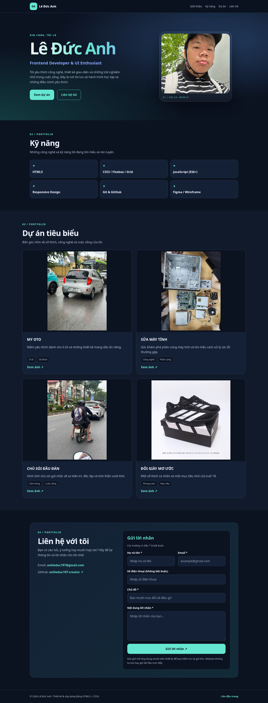
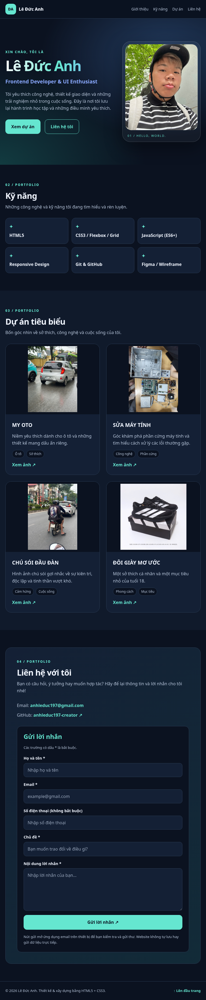
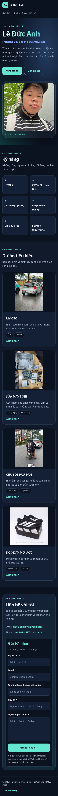

# BÁO CÁO KIỂM THỬ VÀ ĐÁNH GIÁ TRƯỚC BÀN GIAO

## 1. Thông tin chung
- Dự án: My-CV-TiT — Lê Đức Anh
- Phiên bản: v2.3
- Ngày: 24/11/2026
- Công nghệ: HTML5, CSS3.

## 2. Phương pháp
Rà soát mã nguồn và đường dẫn tài nguyên. Chromium trong môi trường kiểm thử chặn truy cập máy chủ cục bộ, nên HTML được nạp trực tiếp với CSS và 5 ảnh gốc nhúng vào phiên kiểm thử. Đã kiểm tra riêng từng đường dẫn src/href, tên tệp và khả năng giải mã JPEG của cả 5 ảnh. Không thay đổi cấu trúc tệp trong bản bàn giao. Ảnh minh chứng chụp toàn trang, tắt chuyển động bằng tùy chọn reduced motion để ổn định hình ảnh.

## 3. Kết quả responsive
| Thiết bị | Viewport | Cột dự án | Tràn ngang | Ảnh | Anchor nội bộ |
|---|---|---:|---|---|---|
| Desktop | 1440×900 | 2 | Không | 5/5 | Đủ đích |
| Tablet | 768×1024 | 2 | Không | 5/5 | Đủ đích |
| Mobile | 390×844 | 1 | Không | 5/5 | Đủ đích |

## 4. Đánh giá theo nhóm tiêu chí
| Nhóm | Kết quả và giới hạn |
|---|---|
| Chức năng | Anchor có đích; đường dẫn ảnh tồn tại; form có 5 trường, trong đó 4 trường bắt buộc; Kiểm tra form ở v2.2: Chromium từ chối form trống và email sai định dạng, chấp nhận các trường hợp lệ khi số điện thoại để trống; mã form không đổi ở v2.3. Chưa kiểm tra gửi email thực tế hoặc kết nối GitHub. |
| Giao diện và tương thích | Chromium hiển thị ba viewport không tràn ngang; các trường và nút gửi của biểu mẫu nằm trong chiều rộng màn hình. Chưa kiểm tra Safari, Firefox hoặc thiết bị thật. |
| Vận hành và hiệu năng | Website tĩnh, không cần build. Ảnh dự án tải ngay khi mở trang. Chưa đo Lighthouse hoặc tốc độ mạng. |
| Bảo mật và dữ liệu | Form chuyển dữ liệu sang ứng dụng email qua mailto, không lưu trên website; không có backend hay script; liên kết mở tab mới có rel=noopener. |
| Mã nguồn và tài liệu | HTML/CSS tách riêng, đường dẫn tài nguyên khớp; README, nhật ký và release note được cập nhật. |
| Triển khai và kiểm thử | Có ba ảnh chụp; chưa kiểm tra GitHub Pages thực tế. |

## 5. Kiểm thử bổ sung cần thực hiện
- Mở bằng Live Server trên máy cá nhân và bấm thử từng liên kết.
- Kiểm tra animation xuất hiện, hover, điều hướng cuộn mượt và tùy chọn giảm chuyển động.
- Kiểm tra bản triển khai GitHub Pages, kiểm tra ứng dụng email mở đúng và xác nhận địa chỉ nhận thư.

## 6. Minh chứng

## 7. Kết luận
Bản v2.3 chuẩn hóa tên và đường dẫn ảnh, tăng kích thước khung dự án, giữ nguyên form liên hệ và animation. Kiểm thử bố cục Chromium đạt các tiêu chí nêu tại mục 3; cần hoàn thành kiểm thử tương tác và triển khai trước khi khẳng định website hoạt động đầy đủ trên môi trường thật.
